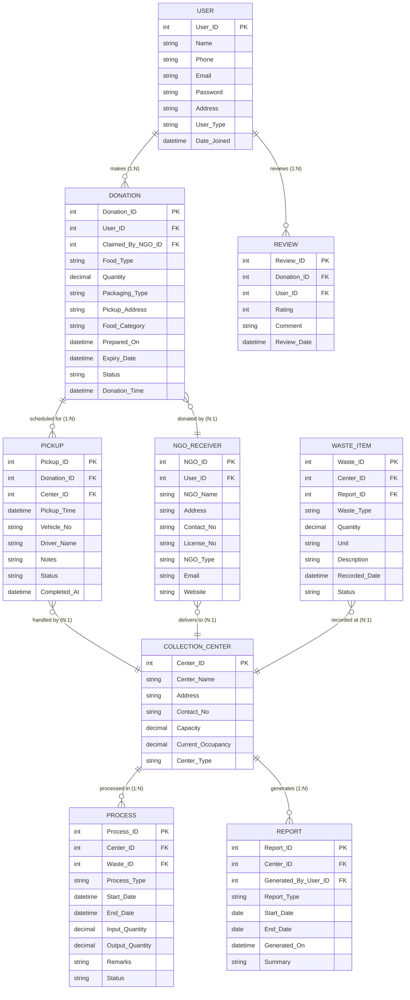

# Smart Food Waste Reduction & Donation Management System
### Complete Relational DBMS Course Project (Normalized 3NF MySQL + Flask Full-Stack)

[](https://www.mysql.com/)
[](https://flask.palletsprojects.com/)
[]()
[]()

A complete, production-ready, college-level DBMS course project designed for second-year engineering students to understand, demonstrate, and explain during a Database Management Systems (DBMS) laboratory examination and viva.

---

## 1. Project Overview & Objectives

### Problem Statement
Commercial food establishments (restaurants, banquet halls, hotels, university cafeterias, and supermarkets) produce significant edible surplus food daily. Simultaneously, charitable food banks, homeless shelters, and orphanages face severe food deficits. When surplus food expires or cannot be safely consumed, it is routinely dumped into municipal landfills, generating methane and carbon emissions rather than being recycled into compost or biogas.

### Objectives
1. **Surplus Food Rescue:** Enable verified commercial donors to list edible surplus meals with strict shelf-life tracking and packaging specs.
2. **Atomic Allocation to Certified NGOs:** Allow registered NGOs to claim food batches and schedule pickups using transaction locking, preventing duplicate claims.
3. **Logistics & Dispatch Tracking:** Manage vehicles, drivers, and pickup status transitions (`Scheduled` &rarr; `In Transit` &rarr; `Completed`).
4. **Circular Bio-Processing:** Triage inedible food and spoiled produce into municipal collection centers for aerobic composting, biogas generation, and packaging recycling.
5. **Auditing & Transparency:** Provide verifiable review feedback, automated triggers for occupancy management, and database-backed analytics without hardcoded estimates.

---

## 2. Technology Stack

- **Backend:** Python 3.11 with Flask 3.1
- **Database Engine:** MySQL 8.x / MariaDB 11.x (InnoDB Storage Engine for full ACID compliance)
- **Database Connector:** `mysql-connector-python` (Official MySQL connector)
- **Security:** Werkzeug password hashing (PBKDF2/scrypt salted hashing)
- **Frontend:** Semantic HTML5, Custom Responsive CSS3 (Deep Forest Green `#1B4332`, Cream `#F4F6F0`, Earth Orange `#E76F51`), Vanilla JavaScript (ES6)
- **Visualization:** Chart.js 4 (Interactive doughnut, line, and bar charts)
- **Icons:** Font Awesome 6 (SVG/web fonts)

---

## 3. Database ER Diagram & Relational Modeling

The database schema is normalized to **Third Normal Form (3NF)**, strictly adhering to relational integrity constraints.

### High-Resolution ER Diagram
The system includes a generated diagram at [`ER_Diagram.png`](file:///C:/Users/prath/.gemini/antigravity/scratch/food-waste-management/ER_Diagram.png).

### Canonical Chen ER Diagram & Relationships



The system includes the canonical high-resolution ER diagram image at [`ER_Diagram.png`](file:///c:/Users/prath/.gemini/antigravity/scratch/food-waste-management/ER_Diagram.png) and viewable interactively in the web application at `/er-diagram`.

### Relational Entities & Attributes

| Entity | Primary Key | Foreign Keys | Key Attributes & Description |
| :--- | :--- | :--- | :--- |
| **`USER`** | `User_ID` | None | `Name`, `Phone`, `Email` (UQ), `Password` (Hashed), `Address`, `User_Type` (`Donor`, `NGO/Receiver`, `Recycler`, `Admin`), `Date_Joined` |
| **`NGO_RECEIVER`**| `NGO_ID` | `User_ID` &rarr; `USER` | `NGO_Name`, `Address`, `Contact_No`, `License_No` (UQ), `NGO_Type`, `Email`, `Website` |
| **`COLLECTION_CENTER`** | `Center_ID` | None | `Center_Name`, `Address`, `Contact_No`, `Capacity`, `Current_Occupancy`, `Center_Type` |
| **`DONATION`** | `Donation_ID` | `User_ID` &rarr; `USER`, `Claimed_By_NGO_ID` &rarr; `NGO_RECEIVER` | `Food_Type`, `Quantity`, `Unit`, `Packaging_Type`, `Pickup_Address`, `Food_Category`, `Prepared_On`, `Expiry_Date`, `Status`, `Donation_Time` |
| **`PICKUP`** | `Pickup_ID` | `Donation_ID` &rarr; `DONATION` (UQ), `Center_ID` &rarr; `COLLECTION_CENTER` | `Pickup_Time`, `Vehicle_No`, `Driver_Name`, `Notes`, `Status` (`Scheduled`, `In Transit`, `Completed`, `Cancelled`), `Completed_At` |
| **`WASTE_ITEM`** | `Waste_ID` | `Center_ID` &rarr; `COLLECTION_CENTER`, `Report_ID` &rarr; `REPORT` | `Waste_Type`, `Quantity`, `Unit`, `Description`, `Recorded_Date`, `Status`. *(Resolves the ER diagram's `Report_ID` key conflict)* |
| **`PROCESS`** | `Process_ID` | `Center_ID` &rarr; `COLLECTION_CENTER`, `Waste_ID` &rarr; `WASTE_ITEM` | `Process_Type` (`Composting`, `Recycling`, `Biogas`), `Start_Date`, `End_Date`, `Input_Quantity`, `Output_Quantity`, `Remarks`, `Status` |
| **`REPORT`** | `Report_ID` | `Center_ID` &rarr; `COLLECTION_CENTER`, `Generated_By_User_ID` &rarr; `USER` | `Report_Type`, `Start_Date`, `End_Date`, `Generated_On`, `Summary` |
| **`REVIEW`** | `Review_ID` | `Donation_ID` &rarr; `DONATION`, `User_ID` &rarr; `USER` | `Rating` (1..5 CHECK), `Comment`, `Review_Date`, `UNIQUE(Donation_ID, User_ID)` |

### Normalization Justification (3NF)
- **1NF:** Every column contains atomic (indivisible) values. No repeating groups.
- **2NF:** All non-key attributes are fully functionally dependent on the entire primary key (no partial dependencies on composite keys).
- **3NF:** No non-key attribute is transitively dependent on another non-key attribute. For instance, NGO specific details (`License_No`, `NGO_Type`, `Website`) reside in the dedicated `NGO_RECEIVER` table rather than cluttering `USER` or `DONATION`.

---

## 4. Advanced DBMS Features Implemented

### A. Database Views
1. **`vw_available_donations`:** Real-time query abstraction returning active, non-expired surplus food along with computed `Hours_Until_Expiry` using `TIMESTAMPDIFF(HOUR, NOW(), Expiry_Date)`.
2. **`vw_donation_summary`:** 5-table joined view connecting `DONATION`, `USER` (Donor), `NGO_RECEIVER`, `PICKUP`, and `REVIEW`.
3. **`vw_center_analytics`:** Dynamic view computing capacity utilization percentage `(Current_Occupancy / Capacity) * 100`, total waste logged, and total biological output generated per hub.

### B. Database Triggers
1. **`trg_waste_insert_occupancy`:** Automatically increments a collection center's `Current_Occupancy` when a new waste item is recorded (`AFTER INSERT ON WASTE_ITEM`).
2. **`trg_waste_update_occupancy`:** Decrements center occupancy when waste status transitions to `'Processed'` or `'Disposed'`.
3. **`trg_pickup_complete_donation`:** Automatically updates `DONATION.Status = 'Completed'` when the associated `PICKUP.Status` is marked `'Completed'`.

### C. Stored Procedures & Transactions
1. **`sp_claim_and_schedule_pickup`:**
   - Wraps the reservation of an available donation and creation of a pickup dispatch inside an atomic `START TRANSACTION ... COMMIT` block.
   - Applies row-level locking (`SELECT ... FOR UPDATE`) to prevent race conditions when two NGOs attempt to claim the exact same batch concurrently.
   - Throws error via `SIGNAL SQLSTATE '45000'` if the item has expired or is no longer available, triggering an automatic `ROLLBACK`.
2. **`sp_record_waste_processing`:**
   - Atomically inserts a process execution record and flags the corresponding waste item as `'Processed'`.

---

## 5. Demo Accounts for Laboratory Examination & Viva

For live demonstration during evaluation, the seed data includes ready-to-use accounts for all 4 roles:

| Role | Email | Password | Entity Name | What to Demonstrate |
| :--- | :--- | :--- | :--- | :--- |
| **Administrator** | `admin@foodwaste.org` | `admin123` | System Administrator | Master oversight, user management, audit reports, CSV export |
| **Donor** | `donor.greenleaf@gmail.com` | `donor123` | Green Leaf Restaurant & Banquets | List surplus meals, set expiry dates, edit listings, view feedback |
| **NGO / Receiver** | `ngo.hope@charity.org` | `ngo123` | Hope Feeding Foundation | Browse active feed, claim surplus food, schedule vehicle pickup |
| **Recycler** | `recycler.ecobio@recycle.org` | `recycler123` | EcoBio Sustainable Recyclers | Log inedible waste, trigger composting / biogas / recycling runs |

*Tip: The login page features a 1-click quick-fill strip to instantly populate these credentials.*

---

## 6. Installation & Setup Guide

### Prerequisites
- Python 3.9+ (Installed on system: Python 3.11)
- MySQL Server 8.0+ or MariaDB 10.5+ (Installed on system: MariaDB 11.4)
- Git & VS Code

### Step 1: Open Project in VS Code
Open VS Code and choose **File > Open Folder** &rarr; select:
```
C:\Users\prath\.gemini\antigravity\scratch\food-waste-management
```

### Step 2: Set Up Python Virtual Environment
Open the integrated VS Code terminal (`Ctrl + ` `) and run:
```powershell
# Create virtual environment
python -m venv venv

# Activate on Windows PowerShell
.\venv\Scripts\Activate.ps1
```

### Step 3: Install Dependencies
```powershell
pip install -r requirements.txt
```
*(Dependencies: Flask, mysql-connector-python, Werkzeug)*

### Step 4: Configure Database Credentials
A pre-configured `.env` is included. If your MySQL credentials differ, adjust them in `.env`:
```ini
DB_HOST=127.0.0.1
DB_PORT=3306
DB_USER=root
DB_PASSWORD=
DB_NAME=food_waste_management
SECRET_KEY=smart-food-waste-mgmt-super-secret-key-2026
```

### Step 5: Start MySQL / MariaDB Server
Ensure your local MySQL / MariaDB server is running.
- If using MariaDB command line:
  ```powershell
  & "C:\Users\prath\AppData\Local\Programs\MariaDB\mariadb-11.4.13-winx64\bin\mariadbd.exe" --console
  ```
- Or if running MySQL as a Windows Service, start it via `services.msc` or:
  ```powershell
  net start MySQL
  ```

### Step 6: Initialize and Seed Database
Run the automated initialization utility to create all tables, views, triggers, stored procedures, and sample records:
```powershell
python db_init.py
```
*Alternatively, you can import `schema.sql` and `seed.sql` directly into MySQL Workbench or MariaDB CLI.*

### Step 7: Launch the Application
```powershell
python app.py
```
Open your browser and navigate to:
```
http://127.0.0.1:5000
```

---

## 7. 15 Demonstration Queries for DBMS Viva

The application includes an interactive live query console accessible at `/viva-queries` or directly in [`queries.sql`](file:///C:/Users/prath/.gemini/antigravity/scratch/food-waste-management/queries.sql):

1. **Q1 (INNER JOIN):** Food donations with donor contact information.
2. **Q2 (LEFT OUTER JOIN):** All food listings including unclaimed donations with `COALESCE` handling.
3. **Q3 (4-Table Relational JOIN):** Full lifecycle trace joining `DONATION`, `USER`, `NGO_RECEIVER`, and `PICKUP`.
4. **Q4 (GROUP BY & Aggregations):** `COUNT`, `SUM`, `AVG`, `MIN`, `MAX` calculated across food categories.
5. **Q5 (GROUP BY with HAVING):** Filtering collection hubs where cumulative waste processing exceeds 300 kg.
6. **Q6 (Subquery with IN):** Identifying donors who earned 5-star reviews.
7. **Q7 (Correlated Subquery with NOT EXISTS):** Finding registered NGOs that have not yet claimed any donations.
8. **Q8 (Correlated Subquery):** Finding donations whose quantity exceeds the category average.
9. **Q9 (Cross-Table Scalar Aggregations):** Single-query live KPI dashboard computation.
10. **Q10 (Date/Time Arithmetic):** Shelf-life countdown in hours and classification into `CRITICAL`, `WARNING`, and `SAFE`.
11. **Q11 (Mathematical Yield Ratios):** Output-to-input conversion efficiency percentage per processing type.
12. **Q12 (Capacity Utilization):** Percentage load computation against maximum storage thresholds.
13. **Q13 (Window Function - DENSE_RANK):** Ranking donors by total volume of rescued food.
14. **Q14 (Querying Pre-Compiled Views):** Fast querying on `vw_available_donations` with compound conditions.
15. **Q15 (ACID Transaction & Rollback):** Demonstrating cancellation rollback preserving database state.

---

## 8. Common Errors & Troubleshooting

| Error Message | Root Cause | Solution |
| :--- | :--- | :--- |
| `ERROR 2002 (HY000): Can't connect to server on 'localhost'` | MySQL / MariaDB service is not currently running. | Start MariaDB with `mariadbd.exe --console` or start the Windows MySQL service from `services.msc`. |
| `ERROR 1045 (28000): Access denied for user 'root'@'localhost'` | Password mismatch in `.env`. | Open `.env` and verify `DB_PASSWORD`. Set the correct MySQL root password. |
| `ERROR 1049 (42000): Unknown database 'food_waste_management'` | Database has not been initialized yet. | Run `python db_init.py` or execute `schema.sql` in MySQL client. |
| `Address already in use (Port 5000)` | Another process is using port 5000. | Change port in `app.py` line 670 to `port=5001` or stop the conflicting background process. |
| `ModuleNotFoundError: No module named 'flask'` | Virtual environment is not active or dependencies missing. | Run `.\venv\Scripts\Activate.ps1` and run `pip install -r requirements.txt`. |

---

## 9. Project Directory Structure

```
food-waste-management/
├── app.py                      # Flask Application with role routing & error handlers
├── config.py                   # Environment & configuration loader
├── db.py                       # MySQL connector helper & query execution engine
├── db_init.py                  # CLI utility for automated schema creation and seeding
├── schema.sql                  # 3NF DDL schema with Tables, Views, Triggers, & Procedures
├── seed.sql                    # Realistic seed data for all roles, donations, & processes
├── queries.sql                 # 15+ advanced demonstration queries for viva examination
├── requirements.txt            # Python dependencies (Flask, mysql-connector-python, Werkzeug)
├── ER_Diagram.png              # High-resolution Entity-Relationship diagram
├── generate_er_diagram.ps1     # Script used to generate ER_Diagram.png
├── .env                        # Local database connection settings
├── .env.example                # Example environment configuration
├── README.md                   # Comprehensive project documentation
├── templates/
│   ├── base.html               # Master layout with responsive navbar & notifications
│   ├── index.html              # Landing page with hero, live statistics, & workflow
│   ├── login.html              # Authentication page with 1-click quick-fill demo buttons
│   ├── register.html           # Dynamic registration for Donors, NGOs, and Recyclers
│   ├── donor_dashboard.html    # Donor console: list surplus, set expiry, view reviews
│   ├── ngo_dashboard.html      # NGO console: live available feed, claim, schedule pickup
│   ├── recycler_dashboard.html # Recycler console: center meters, log waste, conversion runs
│   ├── admin_dashboard.html    # Admin console: master oversight, user management, CSV export
│   ├── donations.html          # Public/auth catalog with keyword search and category filters
│   ├── donation_details.html   # Consignment specifications, expiry warnings, reviews
│   ├── pickups.html            # Logistics dispatch tracker with vehicle & driver details
│   ├── collection_centers.html # Municipal triage hubs with capacity progress meters
│   ├── waste_items.html        # Inedible surplus & spoiled produce triage inventory
│   ├── processes.html          # Composting, biogas, and recycling conversion logs
│   ├── reports.html            # Visual analytics with Chart.js & official audit reports
│   ├── reviews.html            # Verified community feedback & food freshness ratings
│   └── viva_queries.html       # Special interactive 15-query live DBMS viva console
└── static/
    ├── css/
    │   └── style.css           # Custom styling (Forest green, cream, status badges)
    ├── js/
    │   └── app.js              # Modals, form validations, and demo credentials filler
    └── images/
```

---

## 10. Summary for College Examination & Viva

When presenting this project to your professor or examiner:
1. **Explain the Normalization:** Show `schema.sql` and explain how `USER` was separated from `NGO_RECEIVER` to achieve 3NF without null redundancy.
2. **Demonstrate Triggers:** Go to `/waste`, log a new waste item of 200 kg, and show how the collection center's `Current_Occupancy` increased automatically without any manual calculation in application code.
3. **Demonstrate Atomic Transactions:** Explain how `sp_claim_and_schedule_pickup` prevents two NGOs from claiming the same perishable meal simultaneously using row-level locking.
4. **Open the Viva Console (`/viva-queries`):** Execute queries live in front of the evaluator to demonstrate multi-table inner/outer joins, correlated subqueries, aggregations with `HAVING`, and window functions (`DENSE_RANK`).
